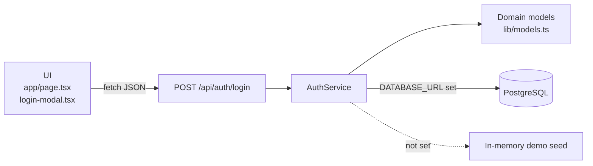

<div align="center">

# 🛡️ SENTINEL

**Geopolitical travel safety and threat advisory platform for Indonesian citizens (WNI).**

[](https://nextjs.org)
[](https://react.dev)
[](https://www.typescriptlang.org)
[](https://tailwindcss.com)
[](https://www.postgresql.org)


</div>

<!-- Add a screenshot or GIF here, e.g.  -->

## About

SENTINEL helps Indonesian travelers check how safe a destination is before and during a trip. Search a country and get:

- **Risk level** (L1 to L4) with a short safety summary
- **Active safety alerts** for that destination
- **Nearest Indonesian embassy (KBRI)** contacts, with a one-tap SOS shortcut for L4 countries

The MVP covers **15 curated benchmark countries** and one origin citizenship (Indonesian passport).

## Features

| Feature | Description | Status |
|---|---|:---:|
| Destination search | English / Bahasa Indonesia names, ISO codes and aliases (e.g. `Japan`, `Jepang`) | ✅ |
| Safety profile | Risk banner, advisory text, active alerts, KBRI contact card, SOS link for L4 | ✅ |
| Interactive risk map | MapLibre GL map with color-coded markers and tooltips | ✅ |
| Authentication + RBAC | Scrypt-hashed passwords, `TRAVELER` and `ADMINISTRATOR` roles | ✅ |
| Watchlist | Save and remove destinations (Traveler only) | ✅ client state |
| Admin mode | Simulate risk-level changes (Administrator only) | ✅ client state |
| Reminder notes | Custom notes on watchlist items | 🟡 skeleton |

<details>
<summary><b>Benchmark countries</b></summary>

| Risk | Level | Countries |
|---|:---:|---|
| 🟢 Low | L1 | Japan, Switzerland, Singapore, Australia, New Zealand |
| 🟠 Elevated | L2-L3 | France, Thailand, Brazil (L2); Turkey, Egypt (L3) |
| 🔴 Critical | L4 | Mali, Haiti, Syria, Yemen, Somalia |

</details>

> [!CAUTION]
> All embassy hotlines, addresses and emails in the dataset are placeholders tagged `[DEMO]`. Do not rely on them in a real emergency.

## Tech Stack

- **Frontend:** Next.js 16 (App Router), React 19, TypeScript, Tailwind CSS v4, shadcn/ui
- **Map:** MapLibre GL
- **Backend:** Next.js Route Handlers, `pg` driver
- **Database:** PostgreSQL (3NF schema)
- **Tooling:** ESLint 9, Turbopack

## Getting Started

### Prerequisites

- Node.js 20 or newer
- PostgreSQL 14 or newer (optional, see below)

### Quick start (no database)

```bash
git clone <repo-url> sentinel-web
cd sentinel-web
npm install
npm run dev
```

Open <http://localhost:3000> and click **Sign In**. Without `DATABASE_URL`, the app uses a built-in in-memory copy of the seed data (`"dataSource": "demo-seed"`).

### With PostgreSQL

```bash
createdb -U postgres sentinel
psql -U postgres -d sentinel -f db/schema.sql
psql -U postgres -d sentinel -f db/seed.sql

cp .env.example .env.local   # then set DATABASE_URL
npm run dev
```

```env
DATABASE_URL=postgresql://postgres:<password>@localhost:5432/sentinel
```

> [!IMPORTANT]
> If `DATABASE_URL` is set but the database is unreachable, the API returns `503`. It never silently falls back to demo data.

### Demo accounts

| Role | Email | Password |
|---|---|---|
| Traveler | `raka.pratama@email.com` | `Sentinel@2026` |
| Administrator | `dimas.handoko@email.com` | `Sentinel@2026` |

These accounts are for local development only. The login modal also has quick-fill buttons.

### Scripts

| Command | Description |
|---|---|
| `npm run dev` | Start the dev server on port 3000 |
| `npm run build` | Create a production build |
| `npm run start` | Serve the production build |
| `npm run lint` | Run ESLint |

## Architecture



The project uses three layers: a presentation layer (React UI), an application layer (route handler, `AuthService`, domain models) and a persistence layer (`pg` pool or demo seed). The domain model in `lib/models.ts` follows the UML class design: an abstract `User` with `Traveler` and `Administrator` subclasses, plus `Destination`, `SafetyAlert`, `EmergencyContact` and `Watchlist`.

<details>
<summary><b>Project structure</b></summary>

```text
sentinel-web/
├── app/
│   ├── api/auth/login/route.ts   # POST /api/auth/login
│   ├── globals.css
│   ├── layout.tsx
│   └── page.tsx                  # Main UI: search, alerts, map, watchlist, admin mode
├── components/
│   ├── auth/login-modal.tsx      # Login dialog
│   └── ui/mapcn-marker-content.tsx
├── db/
│   ├── schema.sql                # PostgreSQL schema (3NF)
│   └── seed.sql                  # Demo users and destinations
├── lib/
│   ├── auth-service.ts           # Login logic
│   ├── db.ts                     # Shared pg pool
│   ├── models.ts                 # OOP domain model
│   └── utils.ts
├── public/
├── .env.example
└── package.json
```

</details>

## API

### `POST /api/auth/login`

```bash
curl -X POST http://localhost:3000/api/auth/login \
  -H "Content-Type: application/json" \
  -d '{"email":"raka.pratama@email.com","password":"Sentinel@2026"}'
```

| Status | Meaning |
|---|---|
| `200` | Valid credentials. Returns `{ success, user, dataSource }` |
| `400` | Empty fields, invalid email, or malformed JSON |
| `401` | Wrong email or password (same message for both) |
| `503` | Database configured but unreachable |

## Security

- **SQL injection:** parameterized queries only
- **Password storage:** salted scrypt hashes, never plaintext
- **Timing attacks:** constant-time comparison with `crypto.timingSafeEqual`
- **Account enumeration:** identical `401` response for unknown email and wrong password
- **Data exposure:** `passwordHash` is stripped from all API responses
- **Input validation:** the server re-validates every field, even after client validation

## Testing

12 manual test cases passed (4 positive, 8 negative), covering valid logins, case-insensitive email, wrong credentials, empty and malformed input, SQL injection, malformed JSON, sign-out, role-based UI gating and database outage (`503`).

```bash
npx tsc --noEmit   # type-check
npm run lint       # lint
```

## Roadmap

- [x] HCI prototype with 15-country whitelist and MapLibre risk map
- [x] PostgreSQL 3NF schema and seed data
- [x] OOP domain model and end-to-end login
- [ ] HttpOnly session cookie / JWT and route guard
- [ ] Persist watchlist, alerts and emergency contacts
- [ ] Login rate limiting and admin audit log
- [ ] Automated tests with Vitest and Playwright

Out of scope for the MVP: push notifications, itinerary planning, multiple origin countries and third-party OAuth.

## Team

**Bluish Pinkies Coco Puff**, built for *Software Implementation and Testing (IMPAL)* and *Human-Computer Interaction (HCI)* (`IF-48-INT`), Telkom University.

## License

This is an academic project. No open-source license has been declared, so all rights are reserved by the authors. Contact the team before reusing the code.