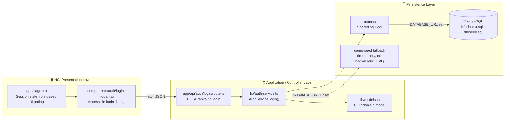
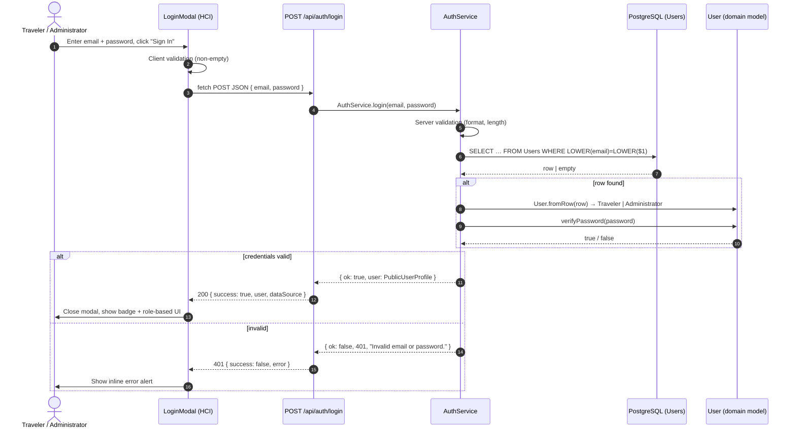

<div align="center">

# 🛡️ SENTINEL

### *Geopolitical Travel Safety & Threat Advisory Platform for Indonesian Citizens (WNI)*

[-000000?style=for-the-badge&logo=nextdotjs&logoColor=white)](https://nextjs.org)
[](https://react.dev)
[](https://www.typescriptlang.org)
[](https://tailwindcss.com)
<br/>
[](https://maplibre.org)
[](https://node-postgres.com)
[-0D9488?style=for-the-badge)](#9-development-roadmap--license)

**Course:** Software Implementation and Testing (IMPAL) & Human-Computer Interaction (HCI) — `IF-48-INT` &nbsp;|&nbsp; **Group:** **Bluish Pinkies Coco Puff**

</div>

---

## 📑 Table of Contents

1. [Overview & Mission](#2-overview--mission)
2. [Key Features & Use Case Traceability](#3-key-features--use-case-traceability)
3. [System Architecture & Object-Oriented Design](#4-system-architecture--object-oriented-design)
4. [Repository Directory Structure](#5-repository-directory-structure)
5. [Getting Started (Local Development)](#6-getting-started-local-development)
6. [Demo Credentials & API Reference](#7-demo-credentials--api-reference)
7. [Verification & QA Test Summary](#8-verification--qa-test-summary)
8. [Development Roadmap & License](#9-development-roadmap--license)

---

## 2. Overview & Mission

**SENTINEL** helps Indonesian citizens (**WNI — Warga Negara Indonesia**) travel abroad more safely. Before or during an international trip, a traveler can:

- 🧭 **Check the ground safety level** of a destination (advisory levels L1–L4),
- 📢 **Read active threat bulletins** (safety alerts) for that destination, and
- 🏛️ **Find the responsible Indonesian diplomatic mission (KBRI)**, including its hotline, address, consular email and local emergency numbers.

### Core MVP Business Rules

| Rule | Description |
|---|---|
| **Hardcoded Origin** | Citizenship is locked to the **Indonesian Passport (`WNI`)**. The MVP does not support multiple origin countries. |
| **15 Whitelisted Benchmark Countries** | Only 15 curated destinations can be searched. They are split into **Low Risk** (`L1` — 🟢 Green), **Elevated Risk** (`L2–L3` — 🟠 Amber/Orange) and **Critical Risk** (`L4` — 🔴 Red + **SOS KBRI** shortcut). |
| **Two Strictly Scoped Roles** | `TRAVELER` and `ADMINISTRATOR` only (`enum UserRole` in [`lib/models.ts`](lib/models.ts)). |

### The 15 Benchmark Countries

| Risk Band | Level | Countries |
|---|:---:|---|
| 🟢 **LOW** | L1 | Japan, Switzerland, Singapore, Australia, New Zealand |
| 🟠 **ELEVATED** | L2–L3 | France, Thailand, Brazil (**L2**); Turkey, Egypt (**L3**) |
| 🔴 **CRITICAL** | L4 | Mali, Haiti, Syria, Yemen, Somalia |

> [!IMPORTANT]
> **Out of scope (by design):** push notifications, itinerary planning, multi-origin citizenship, and third-party OAuth. These were deliberately left out of the class diagram and the codebase.

> [!CAUTION]
> All embassy hotlines, addresses and emails in the demo dataset are tagged `[DEMO]` / `[DEMO - DO NOT DIAL]`. They are placeholders for academic use only. Do not rely on them in a real emergency.

---

## 3. Key Features & Use Case Traceability

| Use Case | Feature | Actor(s) | Implementation | Status |
|---|---|---|---|:---:|
| **UC-1** | **Destination Search (EN / Bahasa Indonesia).** Matches English name, Indonesian name, ISO code or alias (e.g. `Japan`, `Jepang`, `Suriah`) against the whitelist. | Traveler | `handleSearchSubmit()` in [`app/page.tsx`](app/page.tsx); `Traveler.searchDestination()` skeleton in [`lib/models.ts`](lib/models.ts) | ✅ UI |
| **UC-2** | **Safety Alerts & KBRI Contacts.** "Active Safety Bulletins" list and "Diplomatic Protection (WNI)" card for the selected destination. | Traveler, Administrator | [`app/page.tsx`](app/page.tsx); `SafetyAlert`, `EmergencyContact`, `Destination.getActiveAlerts()` | ✅ UI |
| **UC-5** | **End-to-End Scrypt Authentication & RBAC.** Login modal → `POST /api/auth/login` → `AuthService` → PostgreSQL `Users`. The UI role comes **only** from the authenticated user. | Traveler, Administrator | [`login-modal.tsx`](components/auth/login-modal.tsx), [`route.ts`](app/api/auth/login/route.ts), [`auth-service.ts`](lib/auth-service.ts), [`db.ts`](lib/db.ts) | ✅ Full stack |
| **UC-7** | **Interactive MapLibre GL Risk Map.** Color-coded markers (● L1 / ▲ L2–L3 / ◆ L4), image tooltips, click-to-inspect, "Reset World View". | Traveler | [`components/ui/mapcn-marker-content.tsx`](components/ui/mapcn-marker-content.tsx), [`app/page.tsx`](app/page.tsx) | ✅ UI |
| **UC-8** | **Saved Watchlist.** Save/remove destinations. Only a signed-in `TRAVELER` can use it. Administrators and logged-out users see a prompt instead. | Traveler | `toggleWatchlist()` in [`app/page.tsx`](app/page.tsx); `Watchlist` class + `UNIQUE (user_id, destination_country_id)` | ✅ UI (client state) |
| **UC-10** | **Destination Safety Profile.** Dynamic risk banner (level badge, advisory, capital, summary), plus an **SOS Embassy Link (KBRI)** button for L4 destinations. | Traveler | [`app/page.tsx`](app/page.tsx); `Destination.getSafetyProfile()`, `SafetyAlert.isCritical()` | ✅ UI |
| **UC-15** | **Custom Reminder Notes** on watchlist items. | Traveler | `Traveler.setReminder()`, `Watchlist.updateReminderNote()`; `reminder_note VARCHAR(255)` column | 🟡 Skeleton |
| **Alt. Flow** | **Graceful "No Results Found".** Empty, over-long (> 80 chars), malformed or non-whitelisted queries show *"Destination Not Found in 15-Country WNI Whitelist"*. They never fail silently. | Traveler | `invalidQuery` state in [`app/page.tsx`](app/page.tsx) | ✅ UI |
| **Admin** | **Administrator Mode bar.** Simulate a risk-level change (`Set L1`–`Set L4`) for the selected destination. Rendered only for `ADMINISTRATOR`. | Administrator | [`app/page.tsx`](app/page.tsx); `Administrator.updateRiskCategory()` skeleton | ✅ UI (client state) |

> [!NOTE]
> In Week 6, the destination dataset, watchlist and admin risk overrides run as **client-side React state** (`INITIAL_WHITELIST_DB` in `app/page.tsx`). **Login (UC-5)** is the feature built end-to-end down to PostgreSQL. Persisting the other features is planned for Week 7+ (see [Roadmap](#9-development-roadmap--license)).

---

## 4. System Architecture & Object-Oriented Design

### 4.1 Three-Tier Architecture



| Layer | Responsibility | Files |
|---|---|---|
| **HCI (Presentation)** | Collect credentials, validate on the client, show loading/error/success states, switch the UI by role | [`app/page.tsx`](app/page.tsx), [`components/auth/login-modal.tsx`](components/auth/login-modal.tsx) |
| **Application / Controller** | HTTP endpoint, server-side validation, orchestration, domain verification | [`app/api/auth/login/route.ts`](app/api/auth/login/route.ts), [`lib/auth-service.ts`](lib/auth-service.ts), [`lib/models.ts`](lib/models.ts) |
| **Persistence** | User storage and parameterized lookup by email, with an automatic `demo-seed` fallback | [`lib/db.ts`](lib/db.ts), [`db/schema.sql`](db/schema.sql), [`db/seed.sql`](db/seed.sql) |

### 4.2 UML Class Diagram

The diagram below is the refined Week 6 model. It is translated 1:1 into TypeScript in [`lib/models.ts`](lib/models.ts), and every class maps to a table in the Week 5 **3NF** schema.

```mermaid
classDiagram
    direction LR

    class UserRole {
        <<enumeration>>
        TRAVELER
        ADMINISTRATOR
    }
    class RiskCategory {
        <<enumeration>>
        LOW
        ELEVATED
        CRITICAL
    }

    class User {
        <<abstract>>
        -userId: number
        -email: string
        -username: string
        -firstName: string
        -lastName: string
        #userRole: UserRole
        -passwordHash: string
        +getFullName() string
        +verifyPassword(plainPassword: string) boolean
        +toPublicProfile() PublicUserProfile
        +updateProfile(firstName: string, lastName: string) void
        +getPermissions()* string[]
        +fromRow(row)$ User
    }

    class Traveler {
        -watchlist: Watchlist[]
        +searchDestination(query: string) Destination
        +viewSafetyProfile(d: Destination) SafetyProfile
        +addToWatchlist(d: Destination, note?: string) Watchlist
        +removeFromWatchlist(watchlistId: number) boolean
        +setReminder(watchlistId: number, note: string) void
    }

    class Administrator {
        +updateRiskCategory(d: Destination, c: RiskCategory) void
        +publishSafetyAlert(d: Destination, lvl: RiskLevel, title: string, detail: string) SafetyAlert
        +deactivateAlert(a: SafetyAlert) void
        +manageEmergencyContact(c: EmergencyContact) EmergencyContact
    }

    class Destination {
        -countryId: number
        -countryName: string
        -isoAlpha3Code: string
        -isWhitelisted: boolean
        -riskCategory: RiskCategory
        -generalInfo: string
        +isSearchable() boolean
        +getCurrentRiskLevel() RiskLevel
        +getActiveAlerts() SafetyAlert[]
        +getEmergencyContacts() EmergencyContact[]
        +getSafetyProfile() SafetyProfile
    }

    class SafetyAlert {
        -alertId: number
        -destinationCountryId: number
        -riskLevel: RiskLevel
        -title: string
        -detail: string
        -active: boolean
        +isCritical() boolean
        +activate() void
        +deactivate() void
    }

    class EmergencyContact {
        -contactId: number
        -destinationCountryId: number
        -missionName: string
        -hotline: string
        -email: string
        +getContactCard() string
        +updateHotline(hotline: string) void
    }

    class Watchlist {
        -watchlistId: number
        -userId: number
        -destinationCountryId: number
        -reminderNote: string
        -savedAt: Date
        +belongsTo(userId: number) boolean
        +updateReminderNote(note: string) void
    }

    class AuthService {
        <<service>>
        +login(email, password)$ Promise~LoginResult~
    }

    User <|-- Traveler
    User <|-- Administrator
    User --> UserRole
    Destination --> RiskCategory
    Destination "1" *-- "0..*" SafetyAlert : has
    Destination "1" *-- "1..*" EmergencyContact : served by
    Traveler "1" o-- "0..*" Watchlist : saves
    Watchlist "0..*" --> "1" Destination : refers to
    Administrator ..> SafetyAlert : manages
    Administrator ..> EmergencyContact : manages
    AuthService ..> User : authenticates
```



<details>
<summary><b>📐 Week 6 design refinements (F1–F5)</b></summary>

| ID | Finding | Refinement Applied |
|---|---|---|
| **F1** | The Week 5 `Users` table had no credential attribute, which blocked UC-5. | Added `password_hash VARCHAR(255) NOT NULL` (salted scrypt), held as `private passwordHash` and readable only through `verifyPassword()`. |
| **F2** | `user_role` was a plain string, so role behaviour had no clear owner. | `User` became **abstract**, with `Traveler` / `Administrator` subclasses (single-table inheritance + `CHECK` constraint). |
| **F3** | The UI shows L1–L4, but `Destination` stores only `risk_category`. | `riskLevel` is a **derived attribute** (`getCurrentRiskLevel()`), which keeps the schema in 3NF. |
| **F4** | Duplicate watchlist rows were possible. | Added `UNIQUE (user_id, destination_country_id)`. `Watchlist` is an **association class**. |
| **F5** | Login logic had no home in the domain classes. | Introduced the `AuthService` service/controller class (separation of concerns). |

</details>

### 4.3 Login Sequence Diagram (`POST /api/auth/login`)



---

## 5. Repository Directory Structure

```text
sentinel-web/
├── app/
│   ├── api/
│   │   └── auth/
│   │       └── login/
│   │           └── route.ts         # POST /api/auth/login: JSON parsing, delegates to AuthService
│   ├── globals.css                  # Tailwind CSS v4 + tw-animate-css + shadcn design tokens
│   ├── layout.tsx                   # Root layout (Geist fonts, global styles)
│   └── page.tsx                     # Main SENTINEL UI: search (UC-1), alerts/KBRI (UC-2), map (UC-7),
│                                    #   watchlist (UC-8), safety profile (UC-10), RBAC gating, admin bar
├── components/
│   ├── auth/
│   │   └── login-modal.tsx          # Accessible login dialog (validation, loading/error states, demo quick-fill)
│   └── ui/
│       └── mapcn-marker-content.tsx # MapLibre GL wrapper: <Map>, <MapMarker>, <MarkerTooltip>, <MarkerLabel>
├── db/
│   ├── schema.sql                   # PostgreSQL DDL for 5 tables (3NF) + Week 6 password_hash refinement
│   └── seed.sql                     # Demo accounts (scrypt hashes) + sample destinations
├── lib/
│   ├── auth-service.ts              # AuthService.login(): validation → parameterized SQL → verify → public profile
│   ├── db.ts                        # Lazy, shared pg.Pool from DATABASE_URL (returns null → demo-seed mode)
│   ├── models.ts                    # OOP domain model translated 1:1 from the UML class diagram
│   └── utils.ts                     # cn() class-name helper (shadcn alias)
├── public/
│   ├── maplibre-gl-worker.mjs       # MapLibre GL web-worker entry (set via setWorkerUrl)
│   └── *.svg                        # Static icons (file, globe, next, vercel, window)
├── .env.example                     # DATABASE_URL template → copy to .env.local
├── components.json                  # shadcn/ui configuration (aliases, Tailwind CSS path)
├── eslint.config.mjs                # ESLint 9 flat config (next/core-web-vitals + next/typescript)
├── next.config.ts                   # Next.js config (Turbopack + @tailwindcss/turbopack loader)
├── package.json                     # Scripts: dev, build, start, lint
├── tsconfig.json                    # TypeScript compiler options (@/* path alias)
└── README.md                        # You are here
```

---

## 6. Getting Started (Local Development)

### Prerequisites

| Requirement | Version | Notes |
|---|---|---|
| **Node.js** | ≥ 20 | Tested on **v24.20.0** |
| **npm** | Bundled with Node.js | — |
| **PostgreSQL** | ≥ 14 | **Optional.** Without it, the app runs on the built-in `demo-seed` fallback |

```bash
git clone <your-fork-or-repo-url> sentinel-web
cd sentinel-web
```

### Option A — Quick Start (Zero-DB / Demo-Seed Mode)

```bash
npm install
npm run dev
# open http://localhost:3000  →  click "Sign In"
```

**How it works:** if `DATABASE_URL` is **not** set, `getPool()` in [`lib/db.ts`](lib/db.ts) returns `null`, and `AuthService` checks credentials against an **in-memory copy of `db/seed.sql`**: the same users and the same scrypt hashes. A successful login shows a toast ending in *"verified via demo seed (no DATABASE_URL)"*, and the API reports `"dataSource": "demo-seed"`.

### Option B — Full PostgreSQL Mode

```bash
# 1. Create the database, then load the schema and seed data
createdb -U postgres sentinel
psql -U postgres -d sentinel -f db/schema.sql
psql -U postgres -d sentinel -f db/seed.sql

# 2. Configure the connection
cp .env.example .env.local          # PowerShell: Copy-Item .env.example .env.local
#   then edit .env.local:
#   DATABASE_URL=postgresql://postgres:<password>@localhost:5432/sentinel

# 3. Install and run
npm install
npm run dev
```

After a successful login, the toast should say **"verified via PostgreSQL Users table"**, and the API returns `"dataSource": "postgresql"`.

> [!IMPORTANT]
> **No silent fallback.** If `DATABASE_URL` **is** set but PostgreSQL cannot be reached, the API returns **`503 Service Unavailable`**. It does **not** quietly switch to demo-seed mode (verified in **TC-12**).

<details>
<summary><b>📜 Other npm scripts</b></summary>

| Command | Description |
|---|---|
| `npm run dev` | Start the Next.js dev server (Turbopack) on http://localhost:3000 |
| `npm run build` | Create a production build |
| `npm run start` | Serve the production build |
| `npm run lint` | Run ESLint |

</details>

---

## 7. Demo Credentials & API Reference

### 7.1 Seeded Demo Accounts

| Name | Email | Password | Role | What You'll See |
|---|---|---|---|---|
| Raka Pratama | `raka.pratama@email.com` | `Sentinel@2026` | `TRAVELER` | Badge *"Raka Pratama · TRAVELER (WNI)"* + Saved Watchlist |
| Dimas Handoko | `dimas.handoko@email.com` | `Sentinel@2026` | `ADMINISTRATOR` | Badge *"Dimas Handoko · ADMINISTRATOR"* + Administrator Mode bar |

> [!TIP]
> The login modal has **"Demo accounts"** quick-fill buttons, so you don't need to type these credentials.

### 7.2 `POST /api/auth/login`

**Request body**

```json
{ "email": "raka.pratama@email.com", "password": "Sentinel@2026" }
```

**Responses**

| Status | When | Body |
|---|---|---|
| `200 OK` | Valid credentials | `{ "success": true, "user": { userId, email, username, fullName, role }, "dataSource": "postgresql" \| "demo-seed" }` |
| `400 Bad Request` | Empty fields, invalid email format, or malformed JSON | `{ "success": false, "error": "…" }` |
| `401 Unauthorized` | Unknown email **or** wrong password (same message for both) | `{ "success": false, "error": "Invalid email or password." }` |
| `503 Service Unavailable` | `DATABASE_URL` is set but the database is unreachable | `{ "success": false, "error": "Authentication service unavailable. Please try again later." }` |

**Try it** (with `npm run dev` running):

```bash
# curl (macOS / Linux / Git Bash)
curl -X POST http://localhost:3000/api/auth/login \
  -H "Content-Type: application/json" \
  -d '{"email":"raka.pratama@email.com","password":"Sentinel@2026"}'
```

```powershell
# PowerShell (Windows)
Invoke-RestMethod -Uri http://localhost:3000/api/auth/login -Method Post `
  -ContentType 'application/json' `
  -Body '{"email":"raka.pratama@email.com","password":"Sentinel@2026"}'
```

### 7.3 Security Highlights

| Concern | Mitigation |
|---|---|
| **SQL injection** | Parameterized query (`WHERE LOWER(email) = LOWER($1)`) bound by the `pg` driver. User input is never concatenated into SQL. |
| **Password storage** | Salted **scrypt** hash (`scrypt$<saltHex>$<hashHex>`, Node `crypto`). Plaintext is never stored. |
| **Timing attacks** | Hashes are compared with `crypto.timingSafeEqual` (constant time). |
| **Account enumeration** | The same `401 "Invalid email or password."` is returned for an unknown email and for a wrong password. |
| **Data leakage** | `User.toPublicProfile()` strips `passwordHash`, so it never appears in an API response. |
| **Input trust** | The server re-validates every field (type, presence, ≤ 254 chars, email pattern), even though the client validates too. |

---

## 8. Verification & QA Test Summary

**Result: ✅ 12 / 12 test cases passed (4 positive, 8 negative).**
Environment: Windows · Node.js v24.20.0 · Next.js 16.4.2 (Turbopack) · `demo-seed` data source for TC-01 to TC-11, and an unreachable `DATABASE_URL` for TC-12.

| ID | Type | Scenario | Expected Result | Status |
|---|---|---|---|:---:|
| TC-01 | Positive | Valid Traveler login | 200, role `TRAVELER`, badge + watchlist shown | ✅ |
| TC-02 | Positive | Valid Administrator login | 200, role `ADMINISTRATOR`, Administrator Mode bar visible | ✅ |
| TC-03 | Positive | Case-insensitive email (`RAKA.Pratama@Email.com`) | 200, logs in as Raka (`userId: 1`) | ✅ |
| TC-04 | Negative | Wrong password | 401 "Invalid email or password." | ✅ |
| TC-05 | Negative | Unregistered email | 401, **same** message as TC-04 | ✅ |
| TC-06 | Negative | Empty fields | UI blocks the request; API returns 400 | ✅ |
| TC-07 | Negative | Malformed email (`raka@`) | 400 "Please enter a valid email address." | ✅ |
| TC-08 | Negative (Security) | SQL injection (`admin'--@email.com` / `' OR '1'='1`) | 401, no bypass | ✅ |
| TC-09 | Negative | Malformed JSON body (`{not-json`) | 400 "Request body must be valid JSON." | ✅ |
| TC-10 | Positive | Sign Out | Session cleared, "Sign In" button returns, admin bar hidden | ✅ |
| TC-11 | Negative (Authorization) | Traveler tries to reach admin controls | Administrator Mode bar **not** rendered | ✅ |
| TC-12 | Negative (Resilience) | DB unreachable (`127.0.0.1:5999`) | 503, no silent fallback (`ECONNREFUSED` logged) | ✅ |

### Static Checks

```bash
# Type-check the whole project (expected: 0 errors)
npx tsc --noEmit

# Lint (expected: 0 errors; 1 pre-existing, unrelated  warning in app/page.tsx)
npm run lint
```

---

## 9. Development Roadmap & License

### ✅ Completed Milestones

- [x] **Week 4 — HCI Prototype & MapLibre GL**: SENTINEL UI with the 15-country whitelist, EN/ID search, "No Results Found" alternative flow, risk banners (L1–L4), KBRI contact card, SOS shortcut for L4, and the interactive MapLibre GL risk map.
- [x] **Week 5 — PostgreSQL 3NF Schema & Seed**: `Users`, `Destination`, `SafetyAlert`, `EmergencyContact` and `Watchlist` tables with FKs, `CHECK` constraints and seed data ([`db/schema.sql`](db/schema.sql), [`db/seed.sql`](db/seed.sql)).
- [x] **Week 6 — OOP Class Skeleton & End-to-End Login**: refined UML (F1–F5) translated into [`lib/models.ts`](lib/models.ts); UC-5 Login built across HCI → API → `AuthService` → PostgreSQL, with a `demo-seed` fallback; role-based UI gating; 12/12 test cases passing.

### 🔜 Upcoming (Week 7+)

- [ ] Replace client-side session state with a signed **HttpOnly session cookie / JWT**, plus a `proxy`/middleware route guard.
- [ ] **Full CRUD persistence** for the **Watchlist** (UC-8, UC-15 reminder notes) and **Safety Alerts / Emergency Contacts** (UC-2 admin side), on top of the shared `pg` pool.
- [ ] Login rate-limiting and an audit log for administrator actions.
- [ ] Automate TC-01 – TC-12 with a **Vitest + Playwright** test suite.

### 📄 License

This repository is an **academic project** for the *Software Implementation and Testing (IMPAL)* and *Human-Computer Interaction (HCI)* courses (`IF-48-INT`). **No open-source license has been declared yet**, so all rights are reserved by the authors. Contact the group before reusing or redistributing the code.

---

<div align="center">

Built with 💙🩷 by **Bluish Pinkies Coco Puff** · IMPAL & HCI · `IF-48-INT`

</div>
